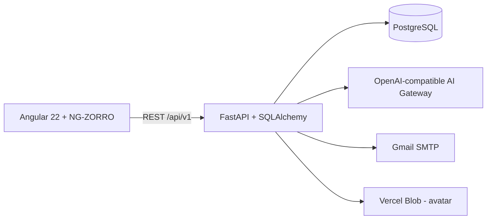

# ITMS — Internship Training Management System

[](https://itms-two.vercel.app)


ITMS là hệ thống quản lý thực tập sinh hoàn chỉnh dành cho ba vai trò **Admin**,
**Mentor** và **Intern**. Dự án tích hợp quản lý đợt thực tập, đào tạo, công việc,
đánh giá, thông báo và trợ lý AI trong một ứng dụng web thống nhất.

**Demo:** <https://itms-two.vercel.app>

## Mục lục

- [Chức năng nổi bật](#chức-năng-nổi-bật)
- [Kiến trúc](#kiến-trúc)
- [Công nghệ](#công-nghệ)
- [Khởi chạy local](#khởi-chạy-local)
- [API và bảo mật](#api-và-bảo-mật)
- [Kiểm tra chất lượng](#kiểm-tra-chất-lượng)
- [Triển khai](#triển-khai)
- [Tài liệu](#tài-liệu)

## Chức năng nổi bật

### Nền tảng chung

- Dashboard và số liệu tổng quan theo từng vai trò.
- Đăng nhập, ghi nhớ đăng nhập, đổi mật khẩu và khôi phục mật khẩu bằng OTP.
- Hồ sơ cá nhân, ảnh đại diện và trung tâm thông báo.
- Trợ lý AI lưu lịch sử hội thoại, trích dẫn nguồn dữ liệu và chỉ truy vấn trong
  phạm vi RBAC của người đang đăng nhập.
- Chín AI tool phục vụ tra cứu Intern, Mentor, lộ trình, tiến độ, task, deadline,
  kết quả quiz, đánh giá và thông báo.

| Vai trò    | Khả năng chính                                                                                                                                                                                                 |
| ---------- | -------------------------------------------------------------------------------------------------------------------------------------------------------------------------------------------------------------- |
| **Admin**  | Quản lý người dùng, vai trò và trạng thái tài khoản; quản lý đợt thực tập, thành viên và phân công Mentor; vận hành LMS; quản lý tiêu chí đánh giá; duyệt yêu cầu vòng đời thực tập; tạo và quản lý thông báo. |
| **Mentor** | Theo dõi Intern phụ trách, lộ trình và kết quả quiz; giao task, review bài nộp và trao đổi; lập/công bố đánh giá; gửi đề xuất gia hạn, dừng hoặc hoàn thành thực tập; xem lịch sử trạng thái và phân công.     |
| **Intern** | Học theo roadmap, mở tài liệu, cập nhật tiến độ; làm quiz và xem kết quả; nhận task, nộp/sửa/xóa bài nộp và bình luận; xem đánh giá đã công bố và thông báo cá nhân.                                           |

## Kiến trúc



- Angular dùng proxy `/api` và `/uploads` tới FastAPI khi phát triển local.
- FastAPI thực thi xác thực, RBAC, nghiệp vụ và cung cấp OpenAPI.
- PostgreSQL được quản lý schema bằng Alembic.
- Avatar dùng Vercel Blob trên production. Tệp task và tài liệu đào tạo hiện lưu
  trên filesystem local; vùng `/tmp` của Vercel là tạm thời, không phải lưu trữ bền vững.

## Công nghệ

| Lớp              | Công nghệ                                                         |
| ---------------- | ----------------------------------------------------------------- |
| Frontend         | Angular 22.1, TypeScript 6, RxJS 7, NG-ZORRO 22.1                 |
| Backend          | Python 3.13+, FastAPI 0.141+, Uvicorn                             |
| Data             | SQLAlchemy 2, Pydantic 2, PostgreSQL 16+, psycopg 3, Alembic      |
| AI & tích hợp    | OpenAI-compatible API, Vercel AI Gateway, Gmail SMTP, Vercel Blob |
| Kiểm thử         | Pytest, Angular Test Runner, Vitest, jsdom                        |
| Chất lượng mã    | Ruff, ESLint, Prettier                                            |
| Package & deploy | uv, npm 11, Vercel Functions, GitHub Actions                      |

## Cấu trúc repository

```text
ITMS/
├── api/                         # Entry point Vercel Python Function
├── backend/
│   ├── app/api/v1/              # REST API
│   ├── app/models/              # SQLAlchemy models
│   ├── app/services/            # Nghiệp vụ và AI tools
│   ├── migrations/versions/     # Alembic revisions
│   ├── scripts/                 # Seed và tiện ích phát triển
│   └── tests/                   # Backend test suite
├── frontend/src/app/            # Angular application
├── docs/                        # Yêu cầu và tài liệu kỹ thuật
├── .github/workflows/ci.yml     # CI pipeline
├── environment.local.example    # Mẫu cấu hình local
└── vercel.json                  # Build, Functions và routing
```

## Khởi chạy local

### Yêu cầu

- Node.js 24 LTS và npm 11.
- Python 3.13+ và [uv](https://docs.astral.sh/uv/).
- PostgreSQL 16+.

### 1. Tạo cấu hình

```powershell
Copy-Item environment.local.example environment.local
```

Trên macOS/Linux, dùng `cp environment.local.example environment.local`. Backend tự
đọc file này tại thư mục gốc; không cần `source` thủ công.

Các nhóm biến quan trọng:

| Nhóm              | Biến                                                               | Mức độ                              |
| ----------------- | ------------------------------------------------------------------ | ----------------------------------- |
| Database          | `ITMS_DATABASE_URL`                                                | Bắt buộc                            |
| Xác thực          | `ITMS_JWT_SECRET`                                                  | Bắt buộc; dùng chuỗi ngẫu nhiên dài |
| Web               | `ITMS_ENVIRONMENT`, `ITMS_CORS_ORIGINS`                            | Nên cấu hình                        |
| Trợ lý AI         | `ITMS_AI_MODEL`, `ITMS_AI_API_KEY` hoặc `AI_GATEWAY_API_KEY`       | Cần khi bật AI                      |
| Email OTP         | `ITMS_SMTP_USERNAME`, `ITMS_SMTP_PASSWORD`, `ITMS_SMTP_FROM_EMAIL` | Cần khi gửi OTP                     |
| Avatar production | `BLOB_READ_WRITE_TOKEN`                                            | Cần nếu môi trường không dùng OIDC  |

Xem đầy đủ giá trị mẫu trong [`environment.local.example`](environment.local.example).
Không commit `environment.local`, `.env*`, token, mật khẩu hoặc URL database thật.

### 2. Cài dependency

```bash
cd backend
uv sync --locked

cd ../frontend
npm ci
```

### 3. Khởi tạo database

```bash
cd backend
uv run alembic upgrade head
uv run python scripts/seed_system_data.py
```

Lệnh seed là tùy chọn, có thể chạy lặp lại và **chỉ hoạt động khi
`ITMS_ENVIRONMENT=development`**. Không seed dữ liệu trên production.

### 4. Chạy ứng dụng

Terminal backend:

```bash
cd backend
uv run uvicorn app.main:app --reload --port 8000
```

Terminal frontend:

```bash
cd frontend
npm start
```

| Dịch vụ         | Địa chỉ                                  |
| --------------- | ---------------------------------------- |
| Web client      | <http://localhost:4200>                  |
| API health      | <http://localhost:8000/api/v1/health>    |
| Database health | <http://localhost:8000/api/v1/health/db> |
| Swagger UI      | <http://localhost:8000/docs>             |

### Tài khoản demo

> Các tài khoản dưới đây chỉ dành cho dữ liệu seed ở môi trường development.

| Vai trò | Email               | Mật khẩu       |
| ------- | ------------------- | -------------- |
| Admin   | `admin@itms.local`  | `Admin@12345`  |
| Mentor  | `mentor@itms.local` | `Mentor@12345` |
| Intern  | `intern@itms.local` | `Intern@12345` |

## API và bảo mật

Tất cả endpoint nghiệp vụ dùng tiền tố `/api/v1`.

| Nhóm          | Endpoint chính                         | Phạm vi                                 |
| ------------- | -------------------------------------- | --------------------------------------- |
| System        | `/health`, `/health/db`                | Kiểm tra dịch vụ và database            |
| Auth          | `/auth/*`, `/me`                       | Đăng nhập, refresh, đăng xuất, mật khẩu |
| Profile       | `/profile`, `/profile/avatar`          | Hồ sơ và ảnh đại diện                   |
| Dashboard     | `/dashboard`                           | Số liệu theo vai trò                    |
| Users         | `/users`                               | Tài khoản, vai trò, trạng thái          |
| Internships   | `/internships`, `/internship-members`  | Đợt, thành viên, phân công và yêu cầu   |
| Mentor        | `/mentor/*`                            | Intern phụ trách, đề xuất và lịch sử    |
| Training      | `/training/*`                          | Roadmap, phase, nội dung, quiz, câu hỏi |
| Learning      | `/learning/*`                          | Học nội dung, tiến độ và làm quiz       |
| Tasks         | `/tasks/*`                             | Task, bài nộp, review, bình luận, tệp   |
| Evaluations   | `/evaluation-criteria`, `/evaluations` | Tiêu chí và đánh giá                    |
| Notifications | `/notifications/*`                     | Gửi, nhận và đánh dấu đã đọc            |
| Assistant     | `/assistant/*`                         | Chat và lịch sử hội thoại AI            |

Các nguyên tắc bảo mật chính:

- Access token là JWT ngắn hạn và chỉ lưu trong bộ nhớ của Angular.
- Refresh token là chuỗi opaque, chỉ lưu hash SHA-256 ở database và được xoay sau
  mỗi lần refresh; trình duyệt nhận token qua cookie `HttpOnly`, `SameSite=Lax` và
  `Secure` trên production.
- Đổi/đặt lại mật khẩu thu hồi toàn bộ phiên. Logout thu hồi phiên hiện tại.
- Backend kiểm tra role, trạng thái tài khoản và data scope ở từng request; UI guard
  không thay thế authorization phía server.
- Header `X-User-Id` chỉ dùng trong `development`/`test`; production luôn yêu cầu JWT.

Chi tiết về trợ lý AI và 9 tool nằm trong
[`docs/chatbot-tools.md`](docs/chatbot-tools.md).

## Kiểm tra chất lượng

Backend:

```bash
cd backend
uv run ruff check .
uv run ruff format --check .
uv run pytest
```

Frontend:

```bash
cd frontend
npm test
npm run lint
npm run format:check
npm run build
```

`npm test` là bước kiểm tra local. CI hiện chạy migration và test cho backend; phía
frontend chạy lint, format check và build trên pull request/push vào `develop` hoặc
`main`.

## Triển khai

Dự án deploy Angular và FastAPI cùng một Vercel project. Nên cài Vercel CLI để quản
lý liên kết project, biến môi trường, deployment và log:

```bash
npm i -g vercel
vercel login
vercel link --yes --project itms
```

Migration production là bước phát hành độc lập, không chạy trong `vercel.json`:

```bash
cd backend
uv run alembic current
uv run alembic heads
uv run alembic upgrade head
uv run alembic current
```

Trước khi migrate, phải kết nối đúng production database, review migration và tạo
backup khi có thay đổi phá hủy dữ liệu. Không dùng `alembic stamp head` để bỏ qua
schema thực tế và không chạy seed trên production.

## Tài liệu

- [Software Requirements Specification](docs/requirements/ITMS-SRS.md)
- [Quy ước API và kiểm soát quyền](docs/s0-01-api-access-control.md)
- [Tài liệu 9 tool của chatbot](docs/chatbot-tools.md)
- [Sơ đồ cơ sở dữ liệu](docs/database/diagram.pdf)
- [Quy ước đóng góp](CONTRIBUTING.md)

## Đóng góp

Tạo nhánh `feat/<scope>`, `fix/<scope>` hoặc `chore/<scope>`, chạy các quality gate
liên quan rồi mở pull request vào nhánh tích hợp mà nhóm đang sử dụng (`develop`
hoặc `main`). Chỉ merge khi CI xanh và migration đã được review. Xem chi tiết tại
[`CONTRIBUTING.md`](CONTRIBUTING.md).

## Phạm vi sử dụng

Dự án phục vụ mục đích học tập và quản lý nội bộ. Repository hiện chưa công bố giấy
phép nguồn mở; vui lòng liên hệ chủ sở hữu trước khi tái sử dụng hoặc phân phối.
